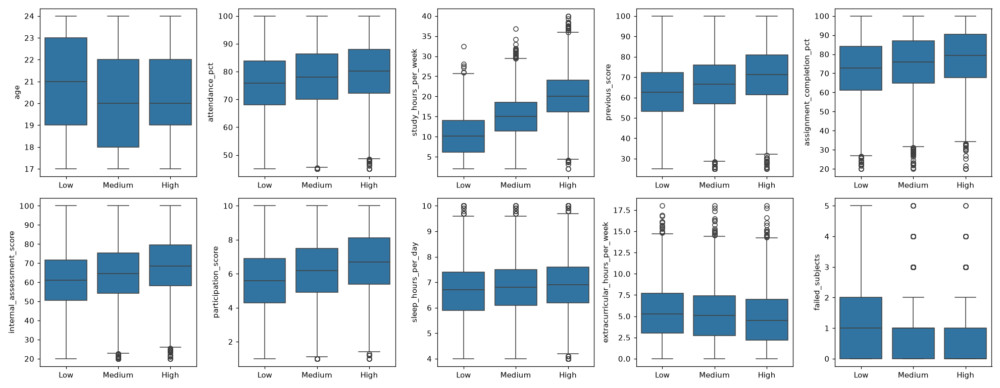
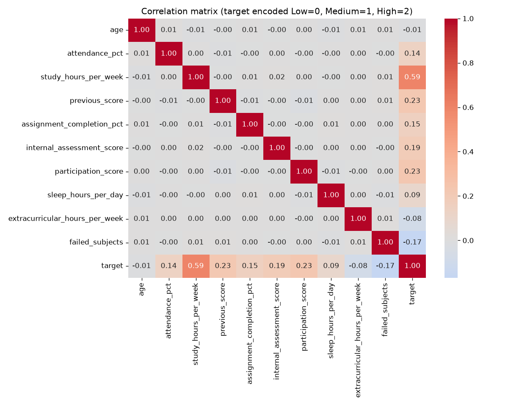
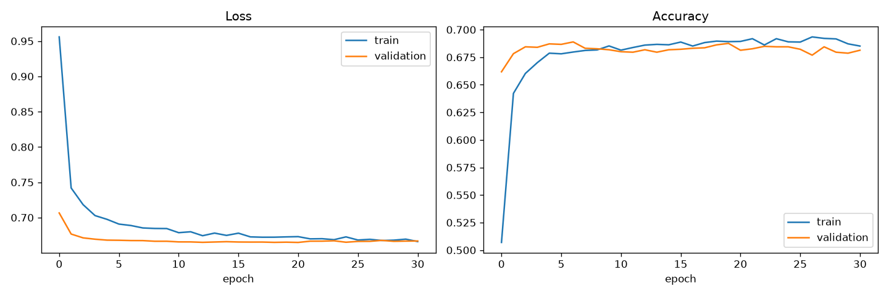
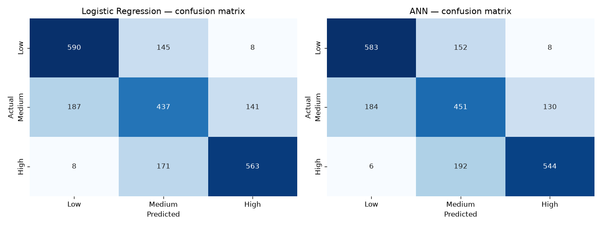

# Evaluation Report: AI-Based Student Performance Risk Predictor (ANN)

* **GitHub repository (source code, notebook, model, app, API):** [https://github.com/adii-madhavi/student-performance-ann](https://github.com/adii-madhavi/student-performance-ann)
* **Project:** Month 3, multi-class classification (Low / Medium / High) with a feed-forward ANN
* **Framework:** TensorFlow 2.21 / Keras 3.15 · Baseline: scikit-learn Logistic Regression
* **Source of every number below:** `notebooks/ann_training.ipynb` (executed) → `reports/metrics.json`

---

## 1. Problem statement

The goal is to predict a student's expected performance category (**Low, Medium or High**) from their academic and behavioural data. The tool is meant to flag at-risk students early. A feed-forward Artificial Neural Network is trained, compared with a traditional ML baseline, evaluated on unseen data, saved, and served through a UI (Streamlit) and a JSON API (FastAPI).

## 2. Step 1: Data understanding

| Item | Finding |
|---|---|
| File | `data/student_data.csv`, **15,000 rows × 12 columns** |
| Identifier | `student_id` (unique, dropped, no predictive meaning) |
| **Target** | `performance_category`: Low / Medium / High |
| **Input features (10)** | `age`, `attendance_pct`, `study_hours_per_week`, `previous_score`, `assignment_completion_pct`, `internal_assessment_score`, `participation_score`, `sleep_hours_per_day`, `extracurricular_hours_per_week`, `failed_subjects` |
| Data types | 8 float, 2 int (`age`, `failed_subjects`), 2 text (`student_id`, target) |
| Missing values | **0** in every column |
| Duplicates | **0** duplicate rows, **0** duplicate IDs |
| Class distribution | Low 4,950 (33.0 %) · Medium 5,100 (34.0 %) · High 4,950 (33.0 %), **balanced**, so no resampling or class weights are needed |

**Feature means by class** (the signal the model learns from):

| Feature | Low | Medium | High |
|---|---|---|---|
| study_hours_per_week | 10.2 | 15.1 | **20.2** |
| previous_score | 62.6 | 66.5 | 70.8 |
| internal_assessment_score | 61.3 | 64.6 | 68.6 |
| participation_score | 5.6 | 6.2 | 6.7 |
| assignment_completion_pct | 72.4 | 75.3 | 78.3 |
| attendance_pct | 75.8 | 78.1 | 79.9 |
| failed_subjects | 1.0 | 0.8 | 0.6 |
| extracurricular_hours_per_week | 5.4 | 5.2 | 4.8 |
| sleep_hours_per_day | 6.7 | 6.8 | 6.9 |
| age | 20.5 | 20.5 | 20.4 |

Study hours give the clearest separation. Prior and internal scores, participation and failed subjects follow. Age and sleep hardly differ between classes. The class distributions **overlap heavily** (boxplots below), and that overlap limits the accuracy any model can reach. In the correlation matrix, the features are independent of each other (|r| ≤ 0.02), and their correlation with the target ranges from 0.59 (study hours) down to about 0 (age).





## 3. Step 2: Preprocessing

1. Dropped `student_id`. No imputation or de-duplication was needed.
2. Label encoding in natural order: **Low = 0, Medium = 1, High = 2**.
3. **Stratified split 70 / 15 / 15**: train 10,500 · validation 2,250 · test 2,250.
4. **StandardScaler** (z-score: `(x − mean) / std`) was **fit on the training set only** and then applied to validation, test and all live predictions. The fitted scaler is saved as `models/scaler.joblib`.

**Why scaling matters for a neural network:** the raw features sit on very different ranges (participation 0–10, attendance 0–100). Unscaled, large-range features dominate the weighted sums `x·W` and produce gradients of very different sizes. Gradient descent then zig-zags and converges slowly or unstably, and ReLU units can saturate or "die". After scaling, every feature has mean 0 and standard deviation 1, so each starts with equal influence and one learning rate suits all weights.

## 4. Step 3: Baseline (multinomial Logistic Regression)

A linear model on the same scaled features (`LogisticRegression(max_iter=1000)`):

| Metric (test set) | Value |
|---|---|
| Accuracy | **0.7067** |
| Precision (macro) | 0.7076 |
| Recall (macro) | 0.7080 |
| F1 (macro) | 0.7075 |

## 5. Step 4: ANN design and justification

```
Input (10 scaled features)
  → Dense 32, ReLU   (352 params)
  → Dropout 0.2
  → Dense 16, ReLU   (528 params)
  → Dropout 0.2
  → Dense 3, Softmax (51 params)   → P(Low), P(Medium), P(High)
Total trainable parameters: 931
```

**Architecture search.** Four candidates were trained the same way and compared on the **validation** set only; the test set stayed untouched:

| Hidden layers | Params | Epochs (early-stopped) | Best val loss | Val accuracy |
|---|---|---|---|---|
| (16) | 227 | 30 | 0.6646 | 0.6831 |
| **(32, 16)** ✔ | **931** | 31 | 0.6647 | 0.6813 |
| (64, 32) | 2,883 | 16 | 0.6682 | 0.6827 |
| (128, 64, 32) | 11,843 | 17 | 0.6654 | 0.6831 |

**Justification:**

* All four are within **0.2 percentage points** of each other, which is inside run-to-run noise. Extra width or depth buys nothing: the problem is close to linearly separable, and what limits accuracy is overlap between classes, not model capacity.
* The larger networks reach their best validation loss earlier and then start to over-fit (early stopping at 16–17 epochs).
* **(32, 16)** was chosen as the smallest network that matches the brief's two-hidden-layer ReLU design. It has enough capacity for non-linear interactions and stays tiny (931 weights), so it trains in seconds and is unlikely to over-fit 10.5 k samples. Its funnel shape (32 → 16 → 3) compresses the 10 inputs into progressively more abstract features.
* **ReLU** in the hidden layers: `max(0, z)` is cheap, does not saturate for positive inputs (no vanishing gradient), and gives the network its non-linearity.
* **Softmax** in the output: one neuron per class, turned into probabilities that sum to 1.
* **Dropout 0.2**: light regularisation. During training it randomly switches off 20 % of hidden units so the network cannot rely on any single neuron.

## 6. Step 5: Training configuration

| Setting | Value | Role |
|---|---|---|
| Loss | **Sparse categorical cross-entropy**, `L = −log p(true class)` | Measures how wrong the predicted probabilities are. Low when the correct class gets high probability. "Sparse" because labels are the integers 0/1/2, not one-hot vectors. |
| Optimizer | **Adam**, learning rate 0.001 | Applies the gradients. Adam combines momentum (running average of past gradients) with adaptive per-weight step sizes. |
| Batch size | **32** | Weights are updated after every 32 samples, about 329 updates per epoch. Small batches give noisy but frequent updates that generalise well. |
| Epochs | up to 150, **EarlyStopping** (monitor `val_loss`, patience 10, restore best weights) | One epoch is one full pass over the training data. Training stopped after **31 epochs**, and the weights from the best epoch (about epoch 21) were restored. |
| Validation data | 2,250 held-out rows | Monitors generalisation on unseen data every epoch and drives early stopping. Never used to update weights. |

**Training curves** (`reports/training_curves.png`): the loss falls quickly in the first ~5 epochs and plateaus around 0.665 by epoch ~12. Train and validation curves stay close together, so the model **does not over-fit**. Training loss sits slightly above validation loss early on because dropout is active only during training.



## 7. Step 6: How the network computes and learns

### Forward propagation (how a prediction flows through the network)
For each layer: **`z = x·W + b`**, then **`a = activation(z)`**. The output of one layer is the input of the next.

The notebook reproduces the trained model's prediction for one test student **by hand in NumPy**, using the learned weights:

```
hidden_1  W(10, 32) b(32,)  active neurons: 14/32     ← ReLU zeroes 18 neurons
hidden_2  W(32, 16) b(16,)  active neurons: 6/16
output    z = [-3.423  0.421  1.453]  -> softmax = [0.0056 0.2612 0.7332]
Manual forward pass : [0.0056 0.2612 0.7332]
model.predict       : [0.0056 0.2612 0.7332]          ← identical
True class: High | Predicted: High
```

### How the output layer produces class probabilities
The output layer emits three raw scores (logits) `z`. Softmax converts them: `p_k = e^{z_k} / Σ_j e^{z_j}`. Every `p_k` lies between 0 and 1, and they sum to 1. The predicted class is the one with the highest probability (argmax), and that probability is reported as the model's confidence. Above, logits (−3.42, 0.42, 1.45) become P(High) = 73.3 %.

### Backpropagation (how errors update the parameters)
1. Run a forward pass on a batch and compute the loss.
2. Apply the **chain rule** backwards from the loss through softmax, the output weights, ReLU and each hidden layer. This gives `∂L/∂w` for every weight and `∂L/∂b` for every bias. Each gradient says how much, and in which direction, that parameter contributed to the error.
3. The optimizer moves every parameter a small step against its gradient: `w ← w − η · ∂L/∂w`.
4. Repeat for every batch and every epoch until the loss stops improving.

The notebook demonstrates one real update with `tf.GradientTape`:

```
hidden_1/kernel grad shape (10, 32)  mean |grad| = 0.01284
hidden_2/kernel grad shape (32, 16)  mean |grad| = 0.00410
output/kernel   grad shape (16, 3)   mean |grad| = 0.02619
...
Batch loss before update: 0.6617  after one SGD step: 0.6404
```

One gradient step lowered the batch loss. Training is this step repeated about 10,000 times.

## 8. Step 7: Evaluation on the unseen test set (2,250 students)

### ANN vs baseline

| Model | Accuracy | Precision (macro) | Recall (macro) | F1 (macro) |
|---|---|---|---|---|
| Logistic Regression (baseline) | **0.7067** | **0.7076** | **0.7080** | **0.7075** |
| ANN (32-16, ReLU, Softmax) | 0.7013 | 0.7064 | 0.7025 | 0.7038 |

### ANN per-class report

| Class | Precision | Recall | F1 | Support |
|---|---|---|---|---|
| Low | 0.754 | 0.785 | 0.769 | 743 |
| Medium | 0.567 | 0.590 | 0.578 | 765 |
| High | 0.798 | 0.733 | 0.764 | 742 |

### Confusion matrices (rows = actual, columns = predicted)

**ANN:**

| | Pred Low | Pred Medium | Pred High |
|---|---|---|---|
| **Low** | **583** | 152 | 8 |
| **Medium** | 184 | **451** | 130 |
| **High** | 6 | 192 | **544** |

**Baseline (Logistic Regression):**

| | Pred Low | Pred Medium | Pred High |
|---|---|---|---|
| **Low** | **590** | 145 | 8 |
| **Medium** | 187 | **437** | 141 |
| **High** | 8 | 171 | **563** |



### Observations
1. **The ANN matches the baseline but does not beat it** (70.1 % vs 70.7 % accuracy; a 0.5-point gap is about 12 students out of 2,250, within noise). The class boundaries in this dataset are essentially **linear**: the categories rise steadily with study hours and scores. A linear model already captures that structure, and the ANN's extra non-linear capacity has nothing extra to learn. This is an honest and useful result. A baseline exists precisely to show whether the added complexity pays off.
2. **About 70 % appears to be the ceiling for this data**, not a weakness of the model. Every architecture from 227 to 11,843 parameters lands at the same accuracy, and validation accuracy matches test accuracy. That points to **overlap between classes** (students with near-identical features but different labels), not under-fitting.
3. **Medium is the hardest class** (F1 0.58). It sits between the other two, so it gets confused in both directions. Low and High are each confused with only one neighbour and score F1 ≈ 0.77.
4. **Errors are almost always "near misses".** 97.9 % of wrong predictions land in an adjacent category. Only **14 of 672** errors (2 %) confuse Low with High. For a risk-flagging tool this matters: a truly Low student is labelled High only 8 times in 743.
5. **Confidence is meaningful.** Average probability is **73.8 %** on correct predictions and **59.4 %** on wrong ones. A low-confidence output (e.g. under 55 %) is a sensible cue for a teacher to look at that student more closely.
6. **No over-fitting.** Train, validation and test accuracy are all about 68–70 %, and early stopping kept the best epoch.

**Possible improvements (out of scope for this brief):** feature engineering (score trends, interaction terms), probability calibration, or tuning the decision threshold to favour **recall on the Low class**, since missing an at-risk student costs more than a false alarm.

## 9. Step 8: Model saving and inference

* `models/student_performance.keras`: the full model (architecture, weights, optimizer state) in native Keras format.
* `models/scaler.joblib`: the fitted StandardScaler. It **must** go with the model, because the network only understands features scaled with the training statistics.
* The notebook reloads the saved model and confirms that it produces **identical predictions** (`np.allclose → True`).

**How the saved model is used during inference** (`predictor.py`, shared by the app and the API):

1. Load the scaler and the `.keras` model once at start-up. No retraining.
2. Arrange the user's raw values in the training column order (read from `scaler.feature_names_in_`).
3. `scaler.transform`, then `model.predict` (forward pass only; dropout is off at inference), which returns 3 softmax probabilities.
4. Return the argmax class, its probability as the confidence, and all three probabilities.

## 10. Steps 9–10: Application and API

**Streamlit app** (`streamlit run app.py`): a form for the 10 features. It shows the predicted category (colour-coded), the prediction probability and a probability bar chart. It was verified in a browser.

**FastAPI** (`uvicorn api:app`):

`POST /predict`
```json
{"age": 20, "attendance_pct": 82, "study_hours_per_week": 6.5, "previous_score": 71,
 "assignment_completion_pct": 80, "internal_assessment_score": 68, "participation_score": 7,
 "sleep_hours_per_day": 7, "extracurricular_hours_per_week": 4, "failed_subjects": 0}
```
Response:
```json
{"predicted_performance": "Medium", "confidence": 0.5327,
 "probabilities": {"Low": 0.3564, "Medium": 0.5327, "High": 0.1108}}
```
Inputs are range-checked by Pydantic (e.g. attendance 0–100). Invalid or missing fields return HTTP 422. `GET /health` returns `{"status": "ok"}`. Interactive docs are at `/docs`. `test_api.py` checks all of this: valid request, probabilities sum to 1, a strong student is predicted **High**, a weak student **Low**, and bad input gets 422. **All checks pass.**

> **Note on the brief's example student:** the PDF's example (6.5 study hours, 82 % attendance, previous score 71, …) is predicted **Medium (53.3 %)**, not High. In *this* dataset study hours are **per week** with a mean of 15.2. High-performing students average 20.2 h/week, so 6.5 h/week is well below even the Low-class average (10.2). The model is reflecting the actual data definition, which the brief itself asks students to follow ("according to the dataset definition").

## 11. Concepts the student must be able to explain (Section 8 of the brief)

**Perceptron vs multi-layer ANN.** A perceptron is a single neuron: a weighted sum `w·x + b` passed through a step function. It can only draw one straight decision boundary (a hyperplane), so it cannot solve non-linearly separable problems such as XOR, and it handles only two classes. A **multi-layer ANN** (MLP) stacks layers of neurons with non-linear activations. The hidden layers learn intermediate features, so the network can model curved, complex boundaries. It is trained with backpropagation, and a softmax output lets it handle many classes.

**Neurons, weights and biases.** A neuron computes `a = f(Σ wᵢxᵢ + b)`. A **weight** sets how strongly, and in which direction, an input influences the neuron, so it encodes the importance the model learned. The **bias** shifts the activation threshold, letting the neuron fire even when all inputs are zero, much like the intercept of a line. Weights and biases are the network's *parameters* (931 here) and are what training adjusts.

**Activation functions.** They add non-linearity. Without them, any stack of layers collapses into one linear transformation. **ReLU** `max(0, z)` is used in the hidden layers: it is fast, its gradient does not vanish for positive inputs, and it is sparse (here only 14 of 32 neurons were active for one student). **Softmax** is used in the output layer to turn scores into a probability distribution. (Sigmoid suits binary output; tanh is an older hidden-layer choice.)

**Forward propagation.** Data flows input → hidden → output. Each layer computes `z = xW + b` and `a = f(z)`, and the final softmax gives class probabilities. See Section 7: the hand computation exactly matches `model.predict`.

**Backpropagation (basic idea).** Compare the prediction with the true label using the loss. Use the chain rule to send the error backwards and compute each weight's gradient (its share of the blame). Nudge every weight in the direction that lowers the loss. Repeat over many batches.

**Loss function and optimizer.** The **loss** (categorical cross-entropy) is a single number for "how wrong" the model is, and it is what training minimises. The **optimizer** (Adam) is the rule that uses the gradients to update the weights: how big a step to take and in which direction. The loss defines the goal; the optimizer decides how to get there.

**Why feature scaling matters.** Explained in Section 3: it puts all features on equal footing and keeps gradients well-conditioned, so training converges faster and more reliably.

**How the output layer produces class probabilities.** Explained in Section 7: there are 3 output neurons, softmax exponentiates and normalises them so they sum to 1, argmax picks the class, and that maximum probability is the confidence.

**How the saved model is used during inference.** Explained in Section 9: load the model and scaler, scale the new input with the training statistics, run a forward pass, and read the softmax output. No retraining, and no weight updates happen.

## 12. Deliverables checklist

| # | Deliverable | Location | Status |
|---|---|---|---|
| 1 | Source code | [github.com/adii-madhavi/student-performance-ann](https://github.com/adii-madhavi/student-performance-ann) | ✅ |
| 2 | Training notebook (EDA, preprocessing, baseline, ANN, training, evaluation) | `notebooks/ann_training.ipynb` (executed, with outputs) | ✅ |
| 3 | Saved ANN model | `models/student_performance.keras` (+ `scaler.joblib`) | ✅ |
| 4 | Prediction application | `app.py` (Streamlit) | ✅ verified in browser |
| 5 | API | `api.py` (FastAPI, `POST /predict`) | ✅ `test_api.py` passes |
| 6 | requirements.txt | `requirements.txt` | ✅ |
| 7 | README.md | `README.md` | ✅ |
| 8 | Evaluation report | this file + `reports/*.png`, `metrics.json` | ✅ |
| 9 | Demo | script in README §"Demo walkthrough" | ⚠ the recording itself must be made by the student |
